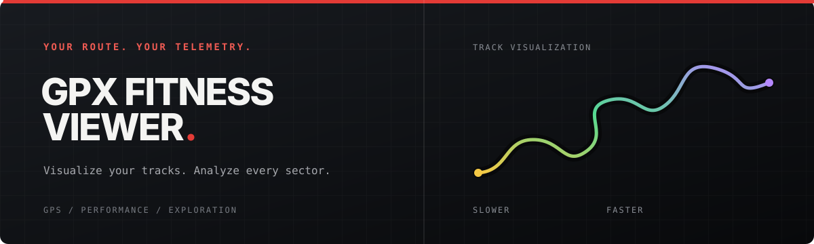

<div align="center">



![Version][version-badge]
![GitHub Pages][gh-pages-badge]
![License][license-badge]
![PRs Welcome][prs-badge]

# GPX Fitness Viewer

**Upload, visualize, and analyze your GPS tracks with an F1 broadcast-inspired interface.**

[Getting Started](#-getting-started) •
[Features](#-features) •
[Build Locally](#-build-locally) •
[Deployment](#-deployment)

</div>

## ✨ Features

- **GPX File Parsing** — Drag-and-drop or click to upload. Browser-native parser, zero server needed.
- **Interactive Map** — Speed-colored track segments (yellow → green → purple, like F1 timing). OpenStreetMap tiles.
- **Timing-Tower Stats** — Distance, moving time, avg/max speed, elevation gain/loss, pace — all in F1 broadcast style.
- **3-Sector Timing** — Track split into three equal sectors with distance and average speed per sector.
- **Waypoints & Multi-Track** — Handle multiple tracks and named waypoints.
- **Dark Theme** — Carbon black background, Ferrari-red accents, monospace data typography.

## 🏗️ Build Locally

```bash
# Requirements: Node.js 22+, pnpm
pnpm install
pnpm dev       # starts dev server on :3000
pnpm test      # runs GPX parser and statistics tests
pnpm build     # produces static dist/
pnpm preview   # preview the built site
```

## 🚀 Deployment

Built as a static site. The `redesign` branch deploys automatically to **GitHub Pages** via GitHub Actions. The previous version remains on the `mvp` branch.

### Manual deploy

Push the `redesign` branch:

```bash
git push origin redesign
```

The `.github/workflows/deploy.yml` workflow builds and deploys to Pages.

### Or deploy anywhere

The `dist/` folder after `pnpm build` is fully static — drop it on any static host (Netlify, Vercel, S3, etc.).

## 🗺️ Usage

1. Open the app
2. Drop a `.gpx` file or click to browse
3. See your route on the map with speed-colored segments
4. Read your performance stats in the timing-tower panels
5. Check sector times in the sector strip

### Sample GPX files

Any GPX file from a GPS watch, phone app, or fitness tracker works. Files with elevation data show gain/loss stats; files without show `--`.

## ⚙️ Tech Stack

| Layer | Technology |
|-------|-----------|
| Framework | React 19 + TypeScript 6 |
| Build | Vite 8 |
| Routing | react-router-dom |
| Styling | Astryx components and broadcast theme + Tailwind CSS v4 |
| Maps | Leaflet + OpenStreetMap tiles |
| GPX | Custom zero-dependency parser (browser DOMParser) |
| Icons | lucide-react |

## 🎨 Design

Pit Wall is a map-first, F1 broadcast-inspired activity workspace. The empty state pairs a GPX drop target with a clearly illustrative route diagram; after upload, the real Leaflet map sits beside a compact timing tower. Equal-distance sectors sit below the route. The export guide shares the same visual system with source tabs and sequential export steps. The custom `broadcast` Astryx theme extends neutral with carbon surfaces, a red action color, and yellow/green/purple speed tokens.

NOTE: For F1 fans, I know there are parts that actually doesn't align with the real broadcast (like the sector strip design). I took creative liberties to simplify and fit the web format while keeping the overall vibe.

## 📄 License

MIT

[version-badge]: https://img.shields.io/badge/version-0.1.0-blue
[gh-pages-badge]: https://img.shields.io/badge/deploy-GitHub%20Pages-blueviolet
[license-badge]: https://img.shields.io/badge/license-MIT-green
[prs-badge]: https://img.shields.io/badge/PRs-welcome-brightgreen
